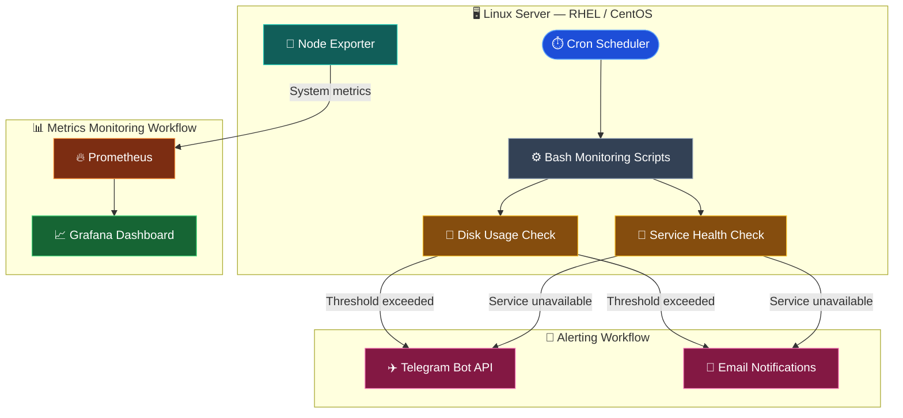
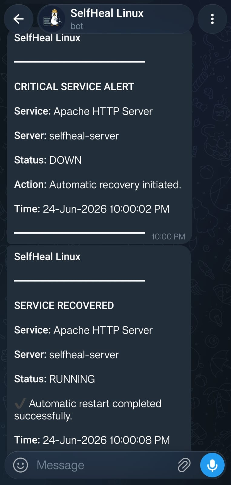
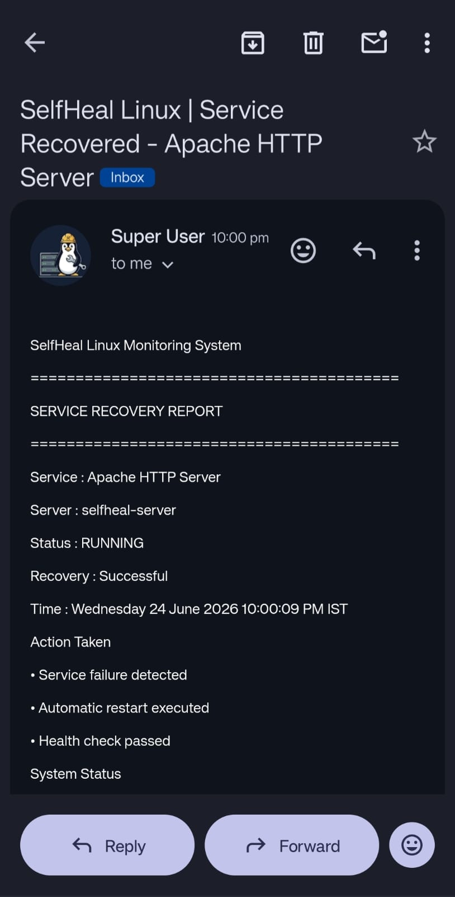

<h1 align="center">📡 Self-Healing Linux Server Monitoring and Alerting System</h1>

<p align="center">
  <strong>Automated Linux Monitoring | Real-Time Alerts | Metrics Visualization</strong>
</p>

<p align="center">
  A Linux monitoring project that combines Bash automation, Prometheus, Node Exporter, and Grafana to detect server health issues and improve operational visibility.
</p>

<p align="center">
  
  
  
  
  
  
</p>


## 📌 Overview
The Self-Healing Linux Server Monitoring and Alerting System is a Linux-based project designed to automate server health checks, detect common operational issues, and provide visibility into system performance.

The project combines Bash monitoring scripts with scheduled execution, notification mechanisms, and an open-source monitoring stack. It helps identify disk-space problems and service failures while providing system metrics and visual dashboards.

The project covers practical DevOps concepts such as Linux administration, shell scripting, task scheduling, monitoring, alerting, and troubleshooting.

## 🎯 Objectives
- Automate disk-usage monitoring and threshold checks.
- Detect stopped or unavailable system services.
- Send instant alerts
- Collect Linux system metrics using Node Exporter.
- Store and query metrics using Prometheus.
- Visualize server performance through Grafana dashboards.
- Reduce repetitive manual checks through scheduled automation.

## 🛠️ Technology Stack

| Technology | Purpose |
|---|---|
|  **Linux (RHEL/CentOS)** | Server operating system |
|  **Bash** | Monitoring scripts |
|  **Cron** | Scheduled checks |
|  **Node Exporter** | Exposes system metrics |
|  **Prometheus** | Metrics collection and storage |
|  **Grafana** | Monitoring dashboards |
|  **Telegram Bot API** | Instant alerts |
|  **Email** | Email notifications |

## 🏗️ Architecture

The system has two workflows:

- **Health checks and alerts:** Cron runs Bash scripts to check disk usage and service status. If a problem is detected, the scripts trigger Telegram or email notifications.
- **Metrics and dashboards:** Node Exporter exposes Linux system metrics, Prometheus collects them, and Grafana displays them in dashboards.


### 🔄 Workflow Summary
| Step | Component | What happens |
|---|---|---|
| 1 | Cron | Runs monitoring scripts at scheduled intervals |
| 2 | Bash scripts | Check disk usage and service status |
| 3 | Alerting | Sends notifications when configured checks fail |
| 4 | Node Exporter | Exposes Linux system metrics |
| 5 | Prometheus | Scrapes and stores metrics |
| 6 | Grafana | Displays metrics in dashboards |

## ✨ Key Features

<table>
  <tr>
    <td width="50%">
      <h3>🖥️ System Monitoring</h3>
      Automated checks for disk usage and service status.
    </td>
    <td width="50%">
      <h3>🔔 Alert Notifications</h3>
      Telegram and email notifications for configured conditions.
    </td>
  </tr>
  <tr>
    <td width="50%">
      <h3>📊 Metrics Visualization</h3>
      Grafana dashboards powered by Prometheus metrics.
    </td>
    <td width="50%">
      <h3>⚙️ Task Automation</h3>
      Cron-based execution of monitoring scripts.
    </td>
  </tr>
  <tr>
    <td width="50%">
      <h3>🐧 Linux Administration</h3>
      Practical service management, filesystem monitoring, and troubleshooting.
    </td>
    <td width="50%">
      <h3>📈 Operational Visibility</h3>
      CPU, memory, disk, and network metrics exposed by Node Exporter.
    </td>
  </tr>
</table>

## 📂 Repository Structure
```text
linux-server-monitoring/
│
├── 📄 README.md
├── 📄 .gitignore
│
├── 🐚 disk_monitor.sh
├── 📲 disk_telegram_alert.sh
├── 🔍 service_monitor.sh
├── 🌐 apache_monitor.sh
│
├── 📁 prometheus/
│   └── ⚙️ prometheus.yml
│
└── 📁 Screenshots/
    ├── 📊 grafana-dashboard.png
    ├── 📡 node-exporter.png
    └── 🔥 prometheus-ui.png
```
## ⚙ Installation & Setup

### 1️⃣ Clone Repository

```bash
git clone https://github.com/SAI-GODGE/Major Project.git
cd self-healing-linux-server
```

### 2️⃣ Make Scripts Executable

```bash
chmod +x *.sh
```

### 3️⃣ Setup Cron Job

```bash
crontab -e
```

Add monitoring task
```bash
*/10 * * * * /path/to/disk_monitor.sh >> /home/its_sai/linux-server-monitoring/monitor.log 2>&1
*/10 * * * * /path/to/service_monitor.sh >> /home/its_sai/linux-server-monitoring/monitor.log 2>&1
```
This runs monitoring every **10 minutes**.

Verify the configuration:
```bash
crontab -l
```
Inspect the monitoring log:
```bash
tail -f /home/its_sai/linux-server-monitoring/monitor.log
```
Ensure that the selected user has the required permissions and that the scripts work correctly in Cron's environment.

## 📊 Monitoring Stack Setup

### Install Node Exporter

```bash
sudo dnf install node_exporter -y
sudo systemctl enable node_exporter
sudo systemctl start node_exporter
```
Check in browser:
http://localhost:9100/metrics

---
### Install Prometheus

Configure `prometheus.yml`:

```yaml
scrape_configs:
  - job_name: "node_exporter"
    static_configs:
      - targets: ["localhost:9100"]
```

Access Prometheus:
http://localhost:9090

---
### Install Grafana

```bash
sudo dnf install grafana -y
sudo systemctl enable grafana-server
sudo systemctl start grafana-server
```
Access Grafana:
http://localhost:3000

---
### Connect Prometheus to Grafana

1. Open Grafana at `http://localhost:3000`.
2. Go to **Connections → Data sources**.
3. Click **Add data source** and select **Prometheus**.
4. Set the Prometheus server URL:

   ```text
   http://localhost:9090
   ```

5. Click **Save & test** to verify the connection.
6. Import the Node Exporter Full dashboard using dashboard ID `1860`, or create a custom dashboard.

If Prometheus and Grafana run on separate hosts or in containers, configure the URL to match their actual network connectivity.

## 📸 Screenshots

### Grafana Dashboard


### Node Exporter Metrics


### Prometheus UI


### Telegram Alert



### Email Alert



# 🔔 Alerting and Health Checks

The monitoring scripts check disk usage and service status and send alerts when a problem is detected. Cron runs the scripts automatically, while Prometheus collects system metrics from Node Exporter.

| Check | Action |
|---|---|
| 💾 Disk Usage | Alerts when disk usage exceeds the threshold |
| ⚙️ Service Status | Alerts when a monitored service stops |
| ⏰ Cron Jobs | Runs scripts at scheduled intervals |
| 📊 System Metrics | Prometheus collects metrics from Node Exporter |

### Telegram Alerts
Configure a Telegram bot token and chat ID to receive alerts when an issue is detected.

### Email Alerts
Configure a mail service or SMTP settings to receive email notifications.

## 🔮 Future Improvements

- Add automatic service recovery with safety checks.
- Integrate Prometheus alert rules and Alertmanager.
- Make alert thresholds configurable.
- Improve logging and error handling.
- Add notification retries and secure monitoring endpoints.
- Automate setup using Bash scripts or Ansible.
- Test recovery scenarios and measure recovery time.

## 📚 What This Project Demonstrates

- 🐧 Linux administration and service management
- 💻 Bash scripting and Cron automation
- 📊 System monitoring with Prometheus and Grafana
- 🔔 Telegram and email alerting
- 🔧 Troubleshooting and error handling
- 🚀 Practical DevOps monitoring skills

## 👨‍💻 Authors

<p align="left">
  <a href="https://www.linkedin.com/in/tejaskanade15/" target="_blank"></a>&nbsp; Tejas Kanade
  <br /><br />
  <a href="https://www.linkedin.com/in/saiprasad-godge-a4098727a/" target="_blank"></a>&nbsp; Saiprasad Godge
  <br /><br />
  <a href="https://www.linkedin.com/in/omkar-ghongde-7b0504290/" target="_blank"></a>&nbsp; Omkar Ghongde
</p>


